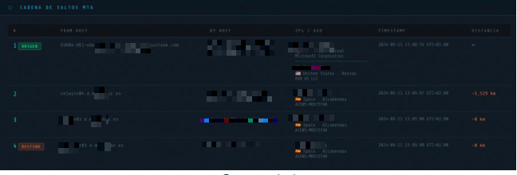
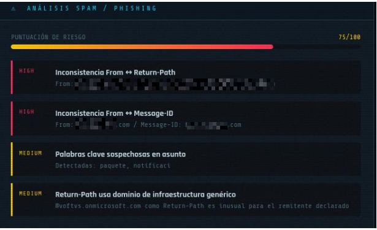
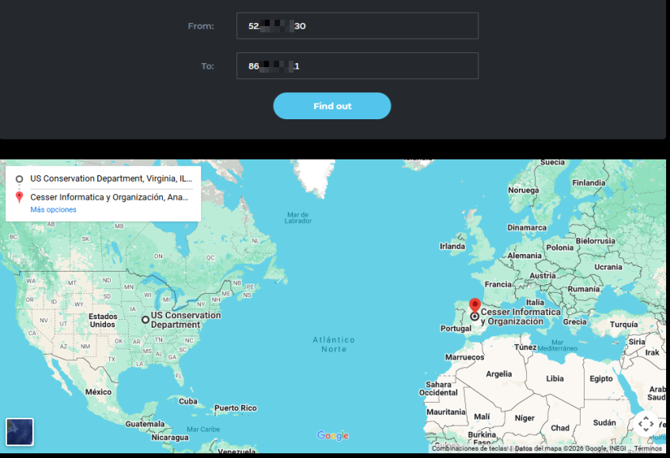

## Contexto

Práctica de la asignatura **Análisis Forense** del Grado en Ingeniería del Software (U-tad). Partíamos de dos cabeceras de correo electrónico en texto plano y había que extraer de cada una toda la información útil para una investigación:

- Remitente, destinatario, asunto, fecha y Message-ID.
- IPs y países de los servidores de origen y destino, e IP del destinatario.
- Ruta seguida por el correo entre servidores (saltos MTA), tiempos de entrega y distancia recorrida.
- Salto en el que el correo cambia de compañía de servidores.
- Valoración de si el mensaje es spam o phishing.

## Por qué hice mi propia herramienta

La herramienta web propuesta en la práctica no funcionaba correctamente, así que probé varios analizadores online alternativos y, además, desarrollé **mi propio analizador con Python y Flask**, ejecutado como aplicación web en local.

Comparar mis resultados con los de otras herramientas resultó ser una de las partes más interesantes: cada una geolocaliza las IPs con fuentes distintas y aplica sus propios criterios de spam, así que las distancias y las puntuaciones de riesgo varían bastante de una a otra.

## Qué hace el analizador

A partir de una cabecera pegada como texto, la aplicación muestra un panel con:

- **Información básica:** From, To, asunto, fecha, Message-ID, Return-Path y Reply-To.
- **Transferencia global:** servidor de origen y de destino, con su país, organización y sistema autónomo (AS).
- **Cadena de saltos MTA:** cada servidor por el que pasa el correo, con su IP, ubicación, marca de tiempo y distancia respecto al salto anterior.
- **Tiempos de entrega:** el tiempo de cada salto y el tránsito total.
- **Análisis de spam y phishing:** una puntuación de riesgo de 0 a 100 basada en reglas, como incoherencias entre el dominio del remitente, el Return-Path y el Message-ID, o la presencia de palabras clave sospechosas en el asunto (por ejemplo, «urgente», «verifica» o «paquete»).

## Caso 1: notificación de paquete

El primer correo simulaba un aviso de entrega de un paquete, un pretexto clásico de phishing. El análisis destacaba varias señales:

- El remitente usaba un dominio, pero el **Message-ID** apuntaba a Gmail y el **Return-Path** a un dominio genérico de Microsoft (`onmicrosoft.com`). Tres dominios distintos para un mismo mensaje es una señal muy clara de suplantación.
- El asunto contenía palabras típicas de este tipo de campañas.
- El correo salía de servidores en Norteamérica y cambiaba de compañía en el primer salto, al llegar a la infraestructura del proveedor de correo del destinatario en España, tras recorrer unos 6.000 km.
- La entrega fue casi inmediata: unos 12 segundos en total.

Mi herramienta le asignó una **puntuación de riesgo de 75/100**.

## Caso 2: correo comercial

El segundo era un correo publicitario de una marca de ropa, enviado desde servidores en San Francisco. Mi herramienta le dio un **55/100** por diferencias entre el dominio del remitente, el del Return-Path y el del Message-ID. Su entrega tardó unas 2 horas y media, algo habitual en envíos masivos que se procesan en cola.

Analizándolo con más detalle, esas diferencias son típicas de las plataformas de email marketing: el Return-Path era un subdominio de la propia marca dedicado a gestionar rebotes, y el Message-ID correspondía a la infraestructura del servicio de envío. Es decir, se trata de un correo comercial no solicitado, pero no de una suplantación como el primero.

## Tecnologías

- **Python** para analizar la cabecera y calcular tiempos y distancias entre saltos.
- **Flask** para la interfaz web local.
- Servicios de **geolocalización de IPs** para ubicar cada servidor.
- Analizadores online (MXToolbox, Microsoft Message Header Analyzer y otros) para contrastar resultados.

## Qué aprendí

- Las cabeceras de un correo cuentan su historia completa: por dónde ha pasado, cuándo y desde qué infraestructura, aunque el contenido del mensaje intente aparentar otra cosa.
- La geolocalización de IPs es aproximada, por lo que las distancias y ubicaciones deben tratarse como indicios, no como certezas.
- Las reglas de detección necesitan matices. Comparar dominios de forma estricta detecta bien la suplantación, pero también marca como sospechosos subdominios legítimos de la misma organización. Una mejora pendiente es comparar el dominio organizativo (por ejemplo, considerar equivalentes `email.marca.com` y `bounce.email.marca.com`) e incorporar la verificación de SPF, DKIM y DMARC.
- Otra mejora pendiente es decodificar correctamente los asuntos con caracteres especiales, que en algunos casos se mostraban con problemas de codificación.

---

## Bibliografía

1. [MXToolbox](https://mxtoolbox.com/)
2. [Sendmarc: Email Header Analysis](https://tools.sendmarc.com/header-analysis)
3. [WhatIsMyIP: Email Header Analyzer](http://whatismyip.com/email-header-analyzer/)
4. [Gaijin.at: E-Mail Header Analyzer](https://www.gaijin.at/en/tools/e-mail-header-analyzer)
5. [DNSAI: Analyze Email](https://dnsai.com/analyze-email/)
6. [Trustifi: Email Analyzer](https://trustifi.com/email-analyzer/)
7. [WintelGuy: Email Trace](https://wintelguy.com/mtrace.pl)
8. [IPLocation: IP Lookup](https://www.iplocation.net/ip-lookup)
9. [InventiveHQ: Email Header Analyzer](https://inventivehq.com/tools/security/email-header-analyzer)
10. [CaptainDNS: Mail Header Analysis](https://www.captaindns.com/en/tools/email-authentication/mail-header-analysis)
11. [Forensic Decoder: Email Header Analyzer](https://forensicdecoder.com/email-header-analyzer/)
12. [Microsoft Message Header Analyzer](https://mha.azurewebsites.net/)
13. [MailTower: Header Analyzer](https://mailheader.mailtower.app/header-analyzer)
14. [2IP: Distance between IPs](https://2ip.io/distance/)
15. [HyperHost: IP Distance](https://hyperhost.ua/tools/en/2ips-distance)
16. Material didáctico de la asignatura Análisis Forense, U-tad.