## Contexto

Práctica de la asginatura **Análisis Forense** del Grado en Ingeniería del Software (U-TAD). El objetivo de esta práctica es capturar la memoria RAM de un sistema Linux en funcionamiento y analizar el volcado en búsqueda de evidencias como: IPs, conexiones de red, dominios, URLs y paquetes de tráfico. 

La RAM es una fuente de información muy valiosa en una investigación, porque contiene datos que no llegan nunca al disco, pero tambíen es volatil, es decir, se pierde su contenido al apagar el equipo, por lo que hay que capturarla con el sistema encendido. 

## Gestión de la memoria en Linux

La gestión de la memoria en Linux es una de las funciones más críticas del núcleo del sistema,
(kernel en adelante). Su objetivo principal es proporcionar a cada proceso un entorno de
ejecución seguro, aislado y aparentemente ilimitado.
Linux utiliza un sistema de Memoria Virtual, lo que significa que las direcciones de memoria que
ven las aplicaciones no coinciden directamente con las posiciones físicas en los módulos de la
RAM. En este punto cabe destacar dos aspectos importantes:
 - Aislamiento: Cada proceso “piensa” que tiene acceso a todo el rango de direcciones del
   sistema, evitando que un proceso acceda o corrompa la memoria de otro.
- MMU: Es el componente físico, que, asistido por el kernel, traduce en tiempo real las
  direcciones virtuales a direcciones físicas, mediante tablas de paginación (page tables)
A su vez, el mapa de memoria en Linux se divide de la siguiente forma:
- Kernel space: Este es el espacio reservado para el núcleo de Linux y sus controladores,
  normalmente incluye el código del núcleo y estructuras de datos relacionados con el
  núcleo.
- User space: Es el espacio reservado para la aplicación del usuario. Suele ser
  gestionado por malloc(), que es una biblioteca de C dedicada a la asignación de
  memoria para programas, aunque otras bibliotecas también pueden realizar esta
  función. Estos espacios de memoria, como definíamos antes, están aislados en su
  propio entorno seguro, haciendo que un proceso de usuario no pueda acceder a la
  memoria de usuario de otro proceso a menos que se autorice de forma explícita.
Además de estos grandes espacios, también se gestionan otras regiones con funciones
específicas:
- Page cache: Es la sección donde contiene archivos accedidos recientemente y
  almacenados en la memoria para mejorar el rendimiento del acceso a los archivos.
- Slab Allocator: Este mecanismo de asignación de memoria lo utiliza el núcleo para
  asignar objetos de datos de tamaño pequeño o mediano, como estructuras de datos,
  búferes de red o búferes de sistemas de archivos.

Este esquema, muestra, de forma aproximada, como esta distribuida la memoria física y las
regiones que se asignan para usos específicos:

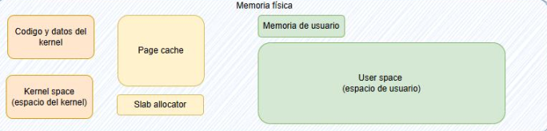

Una vez se ha explicado, de forma genérica, la forma en la que Linux gestiona la memoria ram y
como la divide de forma lógica en diferentes regiones, podemos identificar diferentes
elementos de interés de cara a un análisis forense en estas regiones

El proceso para realizar el análisis es el siguiente:

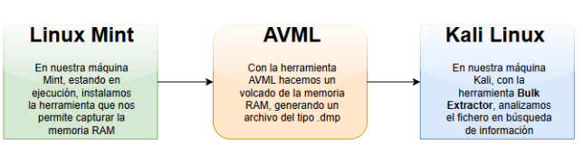

## Herramientas

Las herramientas que se van a utilizar son:
- **AVML**: Se trata de una herramienta portátil desarrollada por Microsoft en Rust para
adquirir memoria volátil en sistemas Linux. Funciona como un binario estático sin
necesidad de compilar en la máquina a analizar, siendo ideal para análisis forense, ya
que soporta múltiples distribuciones, tales como Unbuntu, CentOs, RHEL, Debian y
Fedora.
- **Bulk Extractor**: Es una herramienta de código abierto para el escaneo de imágenes de
disco, archivos o directorios. Es compatible con varios sistemas operativos, como
Windows, GNU Linux, y MacOS. Como salida, genera una serie de ficheros .txt donde se
encuentra la información almacenada en función del tipo que sea, lo cual facilita mucho
la búsqueda de determinados parámetros.
- **Linux Mint**: Es una distribución de Linux basada en Ubuntu y Debian, diseñada para ser
fácil de usar, elegante y cómoda, lo que la convierte en una de las mejores alternativas a
Windows y MacOS
- **Kali Linux**: Kali Linux es una distribución especializada en seguridad informática,
auditoría, pruebas de penetración y análisis forense. Esta basada en Debian y es
mantenida por Offensive Security. Es junto a ParrotOS, las principales distribuciones de
Linux en materia de seguridad informática


## Desarrollo

### Preparación del entorno

En primer lugar, necesitamos instalar la herramienta AVML en nuestra máquina objetivo, y
utilizar una unidad externa de almacenamiento para poder guardar ahí el resultado. Para ello,
aplicamos el comando wget sobre el repositorio de github donde se encuentran las versiones de
la herramienta, seleccionando en nuestro caso, la última versión. Una vez se ha descargado le
asignamos permisos de ejecución con el comando chmod +x y finalmente comprobamos como
se ha descargado correctamente y tiene los permisos adecuados.

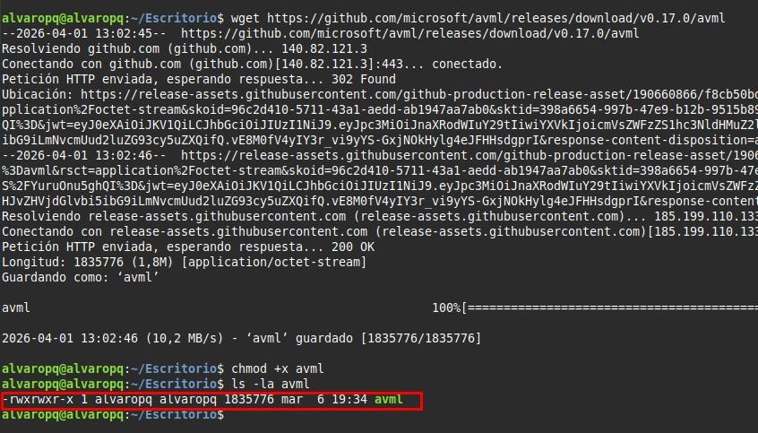

Posteriormente ejecutamos el script con el comando sudo y le indicamos el directorio donde
queremos que lo guarde, así como el nombre del archivo y su extensión:

```bash
sudo ./avml /media/alvaropq/E/MemdumpMint/captura_memoria.dmp
```

Finalmente podemos ver como se ha creado el archivo en el directorio, y como tiene un tamaño
que es coherente con la memoria RAM de nuestro sistema.

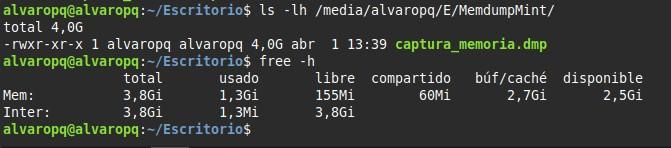

>Nota: Se puede observar como hay una diferencia de tamaño entre el archivo fruto del volcado
> lo que nos indica el comando free de nuestra memoria RAM. Esto es debido a que uno lo
>muestra en gigabytes y otro lo muestra en gibibytes.
>1 𝐺𝑖𝑔𝑎𝑏𝑦𝑡𝑒 = 0,9312 𝐺𝑖𝑏𝑖𝐵𝑦𝑡𝑒

En nuestra máquina Kali, comprobamos que tenemos instalada la versión correcta de Bulk
Extractor y procedemos a realizar el análisis del fichero con el comando 

```bash
bulk_extractor  --version
```

Podemos observar ahora, que el tamaño, esta vez de nuevo en bytes, se corresponden con la información previamente obtenida:

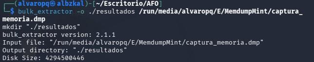


Una vez aplicado el comando, se mostrará sucesiva información de cómo está trabajando y
otros aspectos como el tiempo estimado que queda para finalizar, el tanto por ciento del fichero
sobre el que ha trabajado, y los hilos sobre los que está trabajando. En el momento de la
captura en accts, net y email, es decir, cuales son los elementos que en ese momento está
procesando. 
Finalmente, cuando ha terminado, podemos ver todos los ficheros que ha creado en la carpeta
de resultados, en la que le hemos indicado que deposite el trabajo realizado.

Dentro de estos archivos es donde podemos ver de forma detallada el contenido que había en
ese momento en la memoria ram, diferenciado según el tipo que se trate, así pues, podemos
encontrar:

- Análisis de direcciones IP:
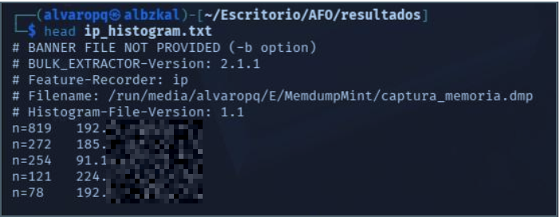

- Análisis de conexiónes IP:
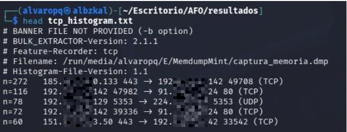

- Análisis de dominios:
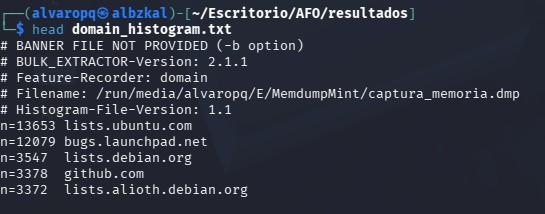

- Análisis de URLs:
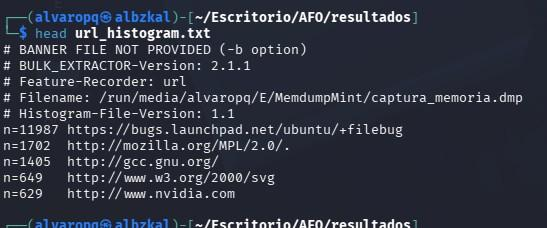

Es importante recalcar que solo se muestran las 5 primeras
entradas, que según se procesan en el archivo, son de las que mas resultados se han obtenido,
por ello se aplica el comando head. Esto no nos impide en cualquier caso buscar por palabras
determinadas dentro de los ficheros para encontrar resultados que nos puedan ser de interés:

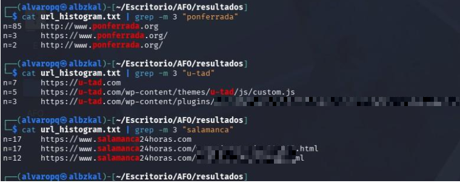

- Análisis de paquetes de tráfico:
 Al igual que los archivos .txt, también se genera un archivo .pcap que contiene los diferentes
paquetes de red que en el momento de realizar el volcado de la memoria se estaban
intercambiando entre la máquina y otros destinos:

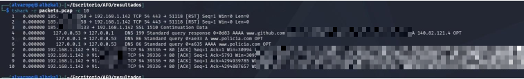

## Conclusiones

En resumen, en esta práctica hemos podido observar y comprender como se gestiona la
memoria RAM en una máquina Linux. En primer lugar se vuelve a verificar que la RAM constituye
una fuente de información de alto valor, y pese a su volatilidad y los riesgos inherentes que
existen en cuanto a su captura, la información mostrada puede resultar muy útil de cara a un
análisis forense.
Mediante AVML se ha obtenido un volcado íntegro de la memoria RAM. Como resultado, se ha
obtenido un fichero de tamaño a la memoria física del equipo, lo cual es una fiel imagen del
estado del sistema en el momento que se realiza el volcado.
El análisis posterior mediante Bulk Extractor ha demostrado la capacidad y potencia de esta
herramienta para extraer datos del archivo binario, identificando direcciones IP, conexiones TCP,
dominios, URLs y paquetes presentes en el tráfico de red. Finalmente es la propia herramienta
la que separa estos datos en diferentes ficheros, facilitando la búsqueda y el filtrado, para
completar correctamente el análisis forense de la memoria del equipo.

## Material y bibliografía

- Material didáctico de la asignatura Análisis Forense, U-tad.
- [Análisis forense de la huella digital de un usuario en sistemas informáticos](https://riunet.upv.es/server/api/core/bitstreams/7d29a71c-afb7-4ac2-9af8-3a1ca59a4ac5/content), RiuNet (Universitat Politècnica de València).
- [Linux explained: memory management](https://zedas.fr/posts/linux-explained-7-memory-management/), zedas.fr.
- [How does Linux memory work?](https://medium.com/@oubang/how-does-linux-memory-work-df6d3fd4db9b), Medium.
- [AVML: documentación oficial](https://github.com/microsoft/avml), Microsoft (GitHub).
- [Introducción al análisis forense de memoria en Linux](https://stuxnet999.github.io/dfir/intro-linux-memory-forensics/), uso de AVML.
- [Análisis del uso de Bulk Extractor](https://www.sciencedirect.com/science/article/pii/S0167404812001472), ScienceDirect.
- [Extracting Forensic Data from a Device Using Bulk Extractor](https://www.researchgate.net/publication/350502325_Extracting_Forensic_Data_from_a_Device_Using_Bulk_Extractor), ResearchGate.
- [Bulk Extractor](https://www.dragonjar.org/bulkextractor.xhtml), DragonJAR.
- [Página del manual de `free`](https://man7.org/linux/man-pages/man1/free.1.html), man7.org.
- [Análisis e inconsistencias de los volcados de memoria en Linux](https://arxiv.org/html/2503.15065v1#S6), arXiv.