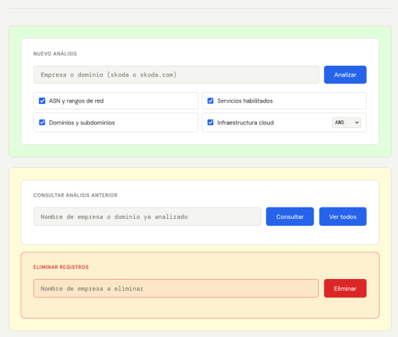
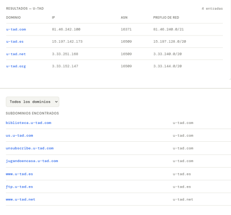
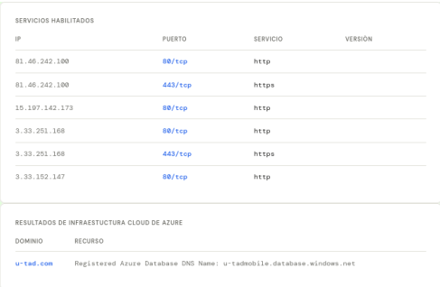

## Contexto

Ejercicio de la asignatura **Hacking Ético** del Grado en Ingeniería del Software (U-tad). El **footprinting** es la fase inicial de una auditoría de seguridad: reunir información pública sobre el objetivo antes de cualquier prueba activa. La idea era automatizar en una sola herramienta varias técnicas que normalmente se harían por separado. Todo el trabajo se realizó sobre Kali Linux y en un entorno controlado.

## Qué hace la herramienta

Monté una **aplicación web** con interfaz en HTML, CSS y JavaScript, un servidor en **Python con Flask** y una base de datos **SQLite** para guardar y consultar los análisis. Desde la web se introduce el nombre o dominio de una empresa, se eligen los módulos a ejecutar, y los resultados se muestran en tablas y se almacenan en el historial.

### Módulos

- **ASN y rangos de red:** resuelve el dominio a una IP y consulta su sistema autónomo (ASN) y el prefijo de red al que pertenece, mediante consultas DNS al servicio de Team Cymru.
- **Dominios y subdominios:** descubre subdominios a partir de una API de inteligencia de dominios, útil para ampliar la superficie de ataque.
- **Servicios habilitados:** lanza un escaneo de puertos con Nmap sobre los más comunes, buscando solo los que están abiertos para que el sondeo sea discreto.
- **Infraestructura cloud:** usa `cloud_enum` para localizar recursos en la nube (AWS, Azure o Google Cloud) asociados al nombre de la empresa.

La aplicación guarda cada resultado en SQLite, permite consultar análisis anteriores sin repetir el trabajo y borrar los registros de una empresa con doble confirmación.

## Decisiones de diseño

- **Escaneo discreto:** limité el escaneo a los puertos más habituales y evité comprobaciones agresivas, para que el sondeo no sea fácilmente detectable.
- **Resolución flexible del objetivo:** la herramienta acepta tanto un nombre de empresa como un dominio completo, y prueba varias extensiones (`.com`, `.net`, `.es`, `.org`) cuando solo se le da el nombre.
- **Análisis cloud por proveedor:** como escanear los tres proveedores a la vez es muy lento, se selecciona uno por análisis.
- **Sin consultas repetidas:** marca cada dominio ya procesado para no volver a consultarlo en la misma ejecución.

## Qué mejoraría

La propia práctica me sirvió para ver un punto importante: la clave de la API estaba escrita directamente en el código. Lo correcto es guardarla en una variable de entorno o en un archivo `.env` fuera del control de versiones, para que no quede expuesta. Es justo el tipo de fallo que esta clase de auditorías busca detectar, y una mejora clara de cara a una versión seria.

## Qué aprendí

- La fase de reconocimiento reúne muchísima información de una empresa solo a partir de fuentes públicas, lo que muestra el valor de reducir la huella expuesta.
- Combinar varias técnicas (DNS, ASN, escaneo de puertos, enumeración cloud) en una sola herramienta con su base de datos facilita mucho el trabajo y deja un registro ordenado de cada análisis.
